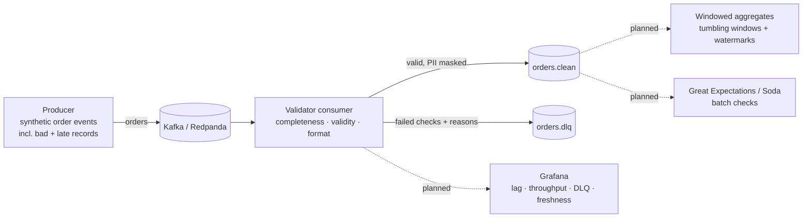

# Streaming Data Quality Pipeline

An event-driven pipeline that checks data quality **as events stream in**: invalid records are routed to a dead-letter queue (DLQ), PII is masked, and quality checks run automatically in CI.

> 🚧 **Work in progress.** See the roadmap below for what's done and what's next.

## Architecture



## Quality rules (current)

| Dimension | Rule | Error code |
|---|---|---|
| Completeness | Required fields present | `missing:<field>` |
| Validity | Product in known list | `invalid:product` |
| Validity | Amount > 0 | `invalid:amount_nzd` |
| Validity | Quantity 1–100 | `invalid:quantity` |
| Format | ISO-8601 timestamp | `invalid:event_time` |
| Format | Parsable JSON | `invalid:json` |

Valid events have their email masked (`a***@example.com`) before being written to `orders.clean`.

## Run it locally

```bash
# 1. Start Kafka (Redpanda) + web console
docker compose up -d                 # console at http://localhost:8080

# 2. Install dependencies
python -m venv .venv && source .venv/bin/activate   # Windows: .venv\Scripts\activate
pip install -r requirements.txt

# 3. In one terminal, start the validator
python src/consumer.py

# 4. In another terminal, send events
python src/producer.py --rate 5 --count 500

# 5. Run the tests
pytest -v
```

Open the console at http://localhost:8080 to see the `orders`, `orders.clean` and `orders.dlq` topics.

## Roadmap

- [x] Local Kafka (Redpanda) with Docker Compose
- [x] Producer generating synthetic events, including bad and late records
- [x] Validator consumer routing failures to a DLQ with error reasons
- [x] PII masking for email
- [x] pytest unit tests for quality rules, run in GitHub Actions CI
- [ ] Tumbling-window aggregates with watermarks for late events
- [ ] Great Expectations / Soda checks on the clean data
- [ ] Observability: consumer lag, throughput, DLQ rate, freshness in Grafana
- [ ] Terraform for the infrastructure
- [ ] Event schema (JSON Schema / Avro) and a small dimensional mart

## Design decisions

- **Redpanda instead of Apache Kafka locally**: it's Kafka-API compatible and runs as a single container, so the code works unchanged against Kafka.
- **DLQ records keep the original event plus the reasons it failed**, so bad data can be investigated and replayed instead of silently dropped.
- **Validation is pure Python with no Kafka dependency**, so every rule is unit tested quickly in CI.
